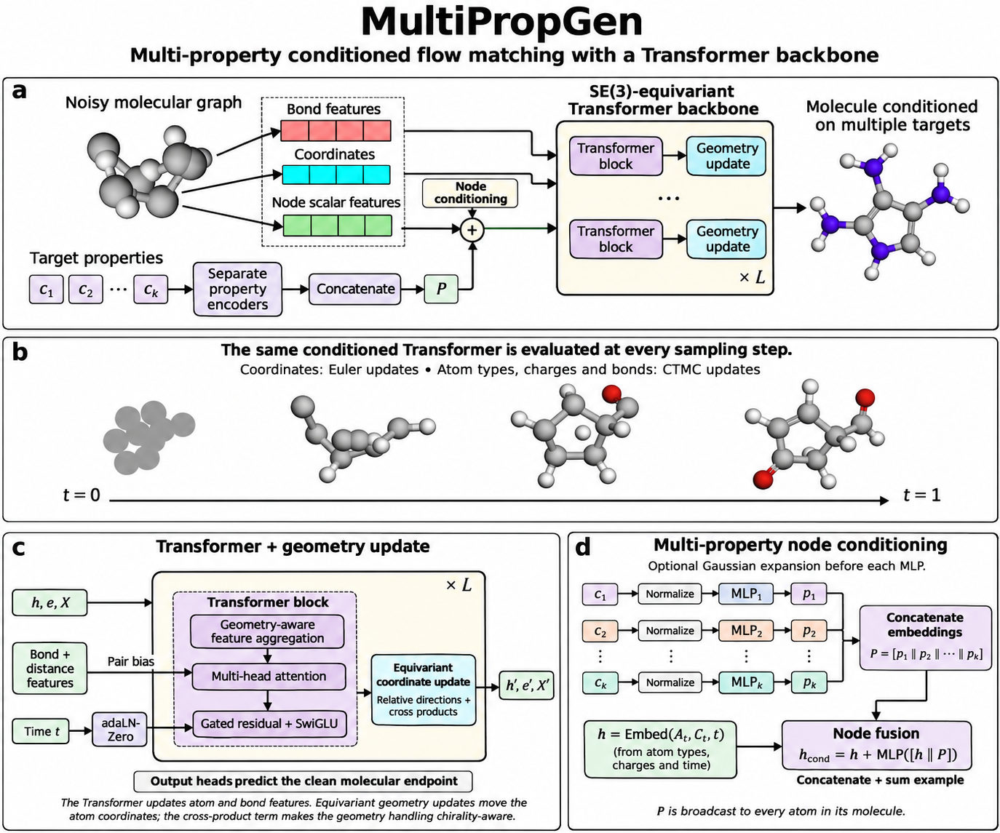
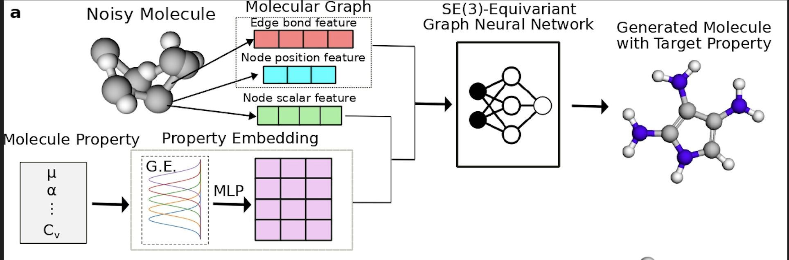

# MultiPropGen

**MultiPropGen** builds on [PropMolFlow](https://github.com/Liu-Group-UF/PropMolFlow) — a geometry-complete flow matching model for 3D de novo molecule generation — and adds a capability not present in the original:

- **Multi-property conditional generation** — condition on any combination of molecular properties simultaneously (e.g., HOMO + LUMO + gap) using a per-property embedder dictionary.
- **Transformer backbone (experimental)** — a [Megalodon](https://arxiv.org/abs/2505.18392)-inspired network of transformer blocks alternating with equivariant geometry updates, selectable in place of the GVP message-passing network with `vector_field.backbone: transformer`.

<p align="center">
  
</p>

**Figure: MultiPropGen overview.**
**(a)** Atom, bond and coordinate features of the noisy molecular graph enter an SE(3)-equivariant Transformer backbone. The target properties are encoded separately, concatenated and added to the atom features.
**(b)** At sampling time the same conditioned network is evaluated at every step from noise (t = 0) to molecule (t = 1). Coordinates take Euler steps, and atom types, charges and bonds take CTMC steps.
**(c)** Each of the L layers is a Transformer block followed by an equivariant coordinate update. The block does geometry-aware feature aggregation, multi-head attention with a bond + distance pair bias, and gated residuals with SwiGLU feed-forward networks, conditioned on time t through adaLN-Zero. The coordinate update moves atoms along relative directions plus a chirality-aware cross-product term.
**(d)** Multi-property node conditioning: each property is normalised and embedded by its own MLP, the embeddings are concatenated into P, and P is fused into every atom's features (concatenate + sum: h_cond = h + MLP([h ‖ P])).

The original PropMolFlow paper and model are described here:
> *PropMolFlow: Property-guided Molecule Generation with Geometry-Complete Flow Matching* — Zeng et al., 2025. [[arXiv]](https://arxiv.org/abs/2505.21469) [[Nature Computational Science]](https://www.nature.com/articles/s43588-025-00946-y)

<p align="center">
  
</p>

**Figure: the original PropMolFlow architecture (baseline).** Reproduced from Zeng et al. (2025), cited above; © the authors.
The noisy molecule is turned into a molecular graph of edge bond features, node position features and node scalar features. **One** molecular property (μ, α, …, C<sub>v</sub>) is passed through a Gaussian expansion (G.E.) and an MLP to give a property embedding, which is combined with the node scalar features. An SE(3)-equivariant graph neural network — the **GVP message-passing** network — then predicts the clean molecule.

Two differences carry through to MultiPropGen: the baseline conditions on **a single property at a time**, where MultiPropGen embeds each of several properties separately and concatenates them (panel **d** above); and the baseline's backbone is **GVP**, which MultiPropGen keeps as the default while adding the transformer as an opt-in alternative. Selecting `backbone: gvp` reproduces this network exactly.

---

## Installation

```bash
# clone this repo and install
git clone <your-repo-url> MultiPropGen
cd MultiPropGen

# create environment (requires CUDA >= 12.8)
conda install mamba
mamba create -n multipropgen python=3.12 nvidia/label/cuda-12.8.1::cuda-toolkit
mamba activate multipropgen
pip install torch==2.7.0 torchvision==0.22.0 torchaudio==2.7.0 --index-url https://download.pytorch.org/whl/cu128
pip install torch-cluster torch_scatter torch_sparse -f https://data.pyg.org/whl/torch-2.7.0%2Bcu128.html
pip install pytorch-lightning==2.5.2 networkx==3.1 einops==0.8.1 rdkit==2025.3.5
pip install torchtyping ase wandb posebusters useful-rdkit-utils py3Dmol
mamba install -c dglteam/label/th24_cu124 dgl=2.4.0.th24.cu124
pip install -e .
```

Or use the provided environment file:
```bash
conda env create -f environment.yml
```

---

## Data Preparation

Download and prepare the QM9 dataset (same as the original PropMolFlow):
```bash
wget https://zenodo.org/records/15700961/files/all_fixed_gdb9.zip
unzip all_fixed_gdb9.zip
mv all_fixed_gdb9.sdf data/qm9_raw/

# preprocess (use any config that has the correct raw data paths)
python process_qm9_cond.py --config=configs/multi_properties/gap_homo_concatenate_sum.yaml
```

---

## Multi-Property Conditioning

### Training

Train a model conditioned on multiple properties at once. Edit a config under `configs/multi_properties/` to set the properties:

```yaml
# configs/multi_properties/gap_homo_concatenate_sum.yaml
dataset:
  conditioning:
    enabled: true
    properties: ['gap', 'homo']   # any subset of QM9 properties
    normalize: true

model_setting:
  property_names: ['gap', 'homo']
  property_embedding_dim: 256
  properties_handle_method: concatenate_sum
```

Available `properties_handle_method` choices: `concatenate`, `sum`, `multiply`, `concatenate_sum`, `concatenate_multiply`.

Available QM9 property names: `alpha`, `cv`, `gap`, `homo`, `lumo`, `mu`.

```bash
python train.py --config=configs/multi_properties/gap_homo_concatenate_sum.yaml
```

This trains a `FlowMolMutli` model with one independent `PropertyEmbedder` per property. Embeddings are concatenated and fused into the node scalar features before the GVP conv layers.

`train.py` picks `FlowMolMutli` automatically whenever the config sets a non-empty `model_setting.property_names`; `--train-multi` forces it. Note that property order is `sorted()` everywhere — in the dataset, the training forward pass and at sampling time — so the embedder for each property is matched by alphabetical position, not by the order written in the YAML.

### Sampling

**In-distribution** (provide one value per molecule from a `.npz` file):
```bash
python sample_condition.py \
    --model_checkpoint checkpoints/multi/gap_homo/epoch=999-step=XXX.ckpt \
    --sample-multi \
    --n_mols 1000 \
    --max_batch_size 128 \
    --n_timesteps 100 \
    --properties_handle_method concatenate_sum \
    --property_names gap homo \
    --multilple_values_file sampling_input/gap_homo_values.npz \
    --output_file results/gap_homo_in.sdf \
    --analyze
```

The `.npz` file must contain one array per property (keyed by property name) plus optionally `n_atoms` and `property_names`:
```python
np.savez("gap_homo_values.npz",
    gap=gap_values,     # shape [N]
    homo=homo_values,   # shape [N]
    n_atoms=n_atoms,    # shape [N], optional
    property_names=np.array(['gap', 'homo'])
)
```

**Out-of-distribution** (same target values for all molecules):
```bash
python sample_condition.py \
    --model_checkpoint checkpoints/multi/gap_homo/epoch=999-step=XXX.ckpt \
    --sample-multi \
    --n_mols 1000 \
    --max_batch_size 128 \
    --n_timesteps 100 \
    --properties_handle_method concatenate_sum \
    --property_names gap homo \
    --properties_for_sampling '{"gap": 0.35, "homo": -0.27}' \
    --normalization_file_path data/qm9/train_data_property_normalization.pt \
    --output_file results/gap_homo_ood.sdf \
    --analyze
```

### Generating Correlated (size, property) Pairs

For in-distribution sampling, molecule size and properties are correlated. Use `multi_porp2size` to draw from the joint distribution learned from training data:

```python
from multi_porp2size.multi_property_sampler import MultiPropertySampler

sampler = MultiPropertySampler(
    property_dict={'gap': gap_train, 'homo': homo_train},
    n_atoms=n_atoms_train,
    num_bins=50,
    seed=42,
)
samples = sampler.sample(n=1000)
# returns dict with 'gap', 'homo', 'n_atoms' arrays
```

---

## Transformer Backbone

The vector field (the network that predicts the clean molecule from a noisy one at each flow-matching step) can use either the original GVP message-passing backbone or a Megalodon-inspired transformer. Only the backbone changes: the input embeddings, the multi-property conditioning (`properties_handle_method`), the CTMC flow matching of atom types / charges / bonds, the loss and the output heads are shared by both.

```bash
python train.py --config=configs/multi_properties/gap_mu_concatenate_sum_transformer.yaml
```

To use it with any other config, add to its `vector_field` section:

```yaml
vector_field:
  backbone: transformer        # default: gvp
  transformer:
    n_layers: 8                # (transformer block -> geometry update) pairs
    n_heads: 8                 # n_hidden_scalars must be divisible by n_heads
    mlp_ratio: 4.0             # feed-forward width = mlp_ratio * feature size
    pair_bias: true            # bond + distance features bias the attention scores
    use_cross_product: true    # chirality-aware cross-product term in the coordinate update
    coord_update_clamp: 10.0
```

`n_hidden_scalars`, `n_hidden_edge_feats`, `rbf_dim`, `rbf_dmax` and `n_recycles` are shared with the GVP backbone; the GVP-only keys (`n_vec_channels`, `n_cp_feats`, `n_message_gvps`, ...) are ignored. The backbone choice is saved in the checkpoint's hyperparameters, so `sample_condition.py` needs no extra flag.

Each layer is:

1. **Transformer block** (updates atom and bond features). Each atom first averages an MLP of (its features, a neighbour's features, the bond between them, their distance), so atom, bond and geometric information are combined inside the block. Multi-head attention then runs over all atoms of the same molecule, with an optional per-head bias from bond features and distance. Gated residual updates and SwiGLU feed-forward networks follow for atoms and bonds. Adaptive layer norm (adaLN-Zero, as in DiT) conditions every block on the flow time.
2. **Equivariant geometry update** (moves the atoms): an EGNN-style update along interatomic directions, plus a cross-product term that rotates with the molecule but changes sign under reflection, so mirror images can be told apart (like the cross-product features of the GVP backbone).

Attention is computed over the edges of the batched DGL graph, which is fully connected within each molecule, so it is exact per-molecule attention with no padding. With the example settings the transformer backbone has about 19 M parameters versus about 6.6 M for the default GVP backbone; reduce `n_layers` or `mlp_ratio` for a size-matched comparison.

---

## Model Class Hierarchy

```
FlowMol                  base single-property conditional model
│                        vector field: CTMCVectorField
│
└── FlowMolMutli         multi-property conditional model
                         vector field: CTMCVectorFieldMulti
```

---

## Config Reference

### Multi-property training keys

```yaml
dataset:
  conditioning:
    enabled: true
    properties: ['gap', 'homo']   # list of property names
    normalize: true               # z-score normalize property values

model_setting:
  property_names: ['gap', 'homo'] # must match dataset.conditioning.properties
  property_embedding_dim: 256
  properties_handle_method: concatenate_sum
```

---

## Property Evaluation

After sampling, evaluate predicted property values using the pretrained GVP regressors from the original PropMolFlow (download from [Zenodo](https://zenodo.org/records/15700961)):

```bash
python multipropgen/property_regressor/test_regressor.py \
    --checkpoint multipropgen/property_regressor/model_output/gap/checkpoints/gvp-regressor-epoch=XXX.ckpt \
    --config multipropgen/property_regressor/configs/test.yaml \
    --input results/gap_homo_ood.sdf \
    --output prediction_result/gap_result.pt \
    --properties_values 0.35 \
    --property_name gap
```

---

## Citation

If you use this code, please cite the original PropMolFlow paper:

```bibtex
@article{zeng_propmolflow_2026,
	title = {{PropMolFlow}: property-guided molecule generation with geometry-complete flow matching},
	copyright = {2026 The Author(s), under exclusive licence to Springer Nature America, Inc.},
	issn = {2662-8457},
	shorttitle = {{PropMolFlow}},
	url = {https://www.nature.com/articles/s43588-025-00946-y},
	doi = {10.1038/s43588-025-00946-y},
	language = {en},
	urldate = {2026-01-21},
	journal = {Nature Computational Science},
	publisher = {Nature Publishing Group},
	author = {Zeng, Cheng and Jin, Jirui and Ambrose, Connor and Karypis, George and Transtrum, Mark and Tadmor, Ellad B. and Hennig, Richard G. and Roitberg, Adrian and Martiniani, Stefano and Liu, Mingjie},
	month = jan,
	year = {2026},
	keywords = {Cheminformatics, Computational science},
	pages = {1--10},
}
```

---

## Acknowledgements

Built on top of [PropMolFlow](https://github.com/Liu-Group-UF/PropMolFlow) and [FlowMol](https://github.com/Dunni3/FlowMol).

---

## License

This project is derived from PropMolFlow and is distributed under the same MIT License.

```
MIT License

Copyright (c) 2025 Liu's Group

Permission is hereby granted, free of charge, to any person obtaining a copy
of this software and associated documentation files (the "Software"), to deal
in the Software without restriction, including without limitation the rights
to use, copy, modify, merge, publish, distribute, sublicense, and/or sell
copies of the Software, and to permit persons to whom the Software is
furnished to do so, subject to the following conditions:

The above copyright notice and this permission notice shall be included in all
copies or substantial portions of the Software.

THE SOFTWARE IS PROVIDED "AS IS", WITHOUT WARRANTY OF ANY KIND, EXPRESS OR
IMPLIED, INCLUDING BUT NOT LIMITED TO THE WARRANTIES OF MERCHANTABILITY,
FITNESS FOR A PARTICULAR PURPOSE AND NONINFRINGEMENT. IN NO EVENT SHALL THE
AUTHORS OR COPYRIGHT HOLDERS BE LIABLE FOR ANY CLAIM, DAMAGES OR OTHER
LIABILITY, WHETHER IN AN ACTION OF CONTRACT, TORT OR OTHERWISE, ARISING FROM,
OUT OF OR IN CONNECTION WITH THE SOFTWARE OR THE USE OR OTHER DEALINGS IN THE
SOFTWARE.
```
